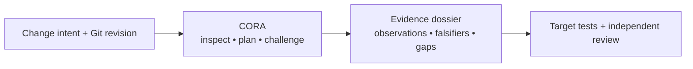
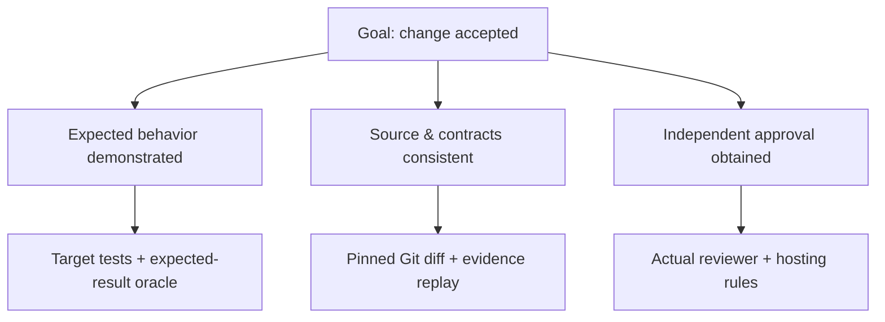

# CORA — Continuous Ontological Repository Assurance

**CORA (Continuous Ontological Repository Assurance)** — **Engineering evidence for AI-assisted software changes.**

**What is CORA?** A local, offline-first Python 3.11+ framework that helps developers and AI coding assistants inspect a Git repository, turn change requests into verifiable acceptance obligations, challenge implementation proposals and produce reproducible pre/post-merge review reports. It connects **the proposed change** to **the source evidence**, **tests or counterexamples**, and **the work still needed**. The result is a reviewable dossier, **not** a decision or a certificate. CORA is **not a coding agent**.

**Why it matters:** a code edit, a green test, a Git SHA and an AI explanation are different observations. A reviewer needs to know what each observation supports, what could refute it, and what remains unverified.

**Scale with limits:** seeded failure scenarios challenge many combinations cheaply; [the numerical methods](#numerical-and-semantic-testing-what-the-numbers-mean) explain why a large test count alone cannot establish correctness.



**Three distinct things:** the **product** is the engineering-assurance workflow; the **software** is the local `cora` CLI (Python package `cora-audit`); the **repository** is [Luke883i/cora](https://github.com/Luke883i/cora), containing source, tests, contracts, CI, documentation and history. See [the engineering map](#engineering-map).

**Choose an entry point**

| Goal | Start · outcome |
| --- | --- |
| Inspect a repository | [First five minutes](#first-five-minutes--quickstart) → pinned Git JSON receipt |
| Review a change or pull request | [One-Run](#one-run--one-command-one-evidence-dossier) + [AI-assisted review](#use-cora-with-an-ai-coding-assistant) → HTML/JSON and open obligations |
| Continue work in a ChatGPT conversation | [ChatGPT session workflow](#use-cora-during-a-chatgpt-conversation-experimental) → portable iteration ZIP |
| Investigate a file, dependency or workflow | [Capabilities](#what-works-today) + [File Lab](docs/FILE_LAB.md) → source-scoped findings |

**Example — ICTC (illustrative, not a new ICTC execution).** Suppose an ICTC pull request changes release-readiness logic. CORA can pin the Git `BASE`/`HEAD`, map source and workflow references, derive the checks that should still hold, and report which evidence is missing. Target-specific test results, actual downstream effects and release approval must be obtained separately. The [documented ICTC source-lineage pilot](docs/GOLD_ASSURANCE.md) is a bounded reference case, **not** a certification of the running ICTC product.

**Current status:** experimental source `cora-audit 1.0.0a5`, now merged with PR46; **not a stable API or verified public release**. The earlier **merged PR41** established the source-level experimental baseline. As checked on 8 November 2026, GitHub still showed a draft `v1.0.0a4` release without downloadable assets, not a published `v1.0.0a5` package. See [release status and obligations](docs/RELEASE.md) before making a delivery claim.

## First five minutes — Quickstart

From an **authorized local checkout of CORA**, install the CLI; `.` is the repository being inspected (replace it with an authorized target path for another repository).

```sh
python -m pip install -e .
cora --help
cora audit . --output /tmp/cora-worktree.json
cora snapshot . --revision HEAD --output /tmp/cora-ledger.json
cora verify-ledger /tmp/cora-ledger.json --repo .
```

- `cora-worktree.json`: working-tree observation, which can include uncommitted changes.
- `cora-ledger.json`: pinned original-Git commit inventory.
- `verify-ledger`: consistency replay against Git objects; not a runtime test or reviewer approval.

Keep reports **outside** the inspected repository. `/tmp` is an illustrative Unix path; choose a suitable directory on Windows. For installation, target paths and troubleshooting see [Getting started](docs/GETTING_STARTED.md) and [the parser-checked CLI reference](docs/CLI_REFERENCE.md).

**Recommended use:** begin with permission to inspect a repository and an exact Git revision; run CORA read-only, inspect its unknowns, then execute appropriate target tests and independent human review separately. No report grants permission to delete, merge or deploy.

**Audience and conditions:** developers, maintainers, reviewers, coding-agent operators and product/assurance owners. Python 3.11+ and Git are needed; target-side execution, Docker, network operations and untrusted ZIPs require separate authorization and containment. There is no hosted CORA service.

**Open source license:** [MIT](LICENSE). This grants reuse of CORA source, not access to others' repositories or approval authority. See [Security](SECURITY.md) and [Contributing](CONTRIBUTING.md).


## Use CORA during a ChatGPT conversation (experimental)

**ChatGPT can help formulate the engineering intent; CORA must actually be executed.** A chat is not a Python runtime, nor an automatic source of Git receipts. A connected execution tool or local operator must run the following commands.

1. Copy [the complete iteration example](examples/chat-step.example.json) to `/tmp/chat-step.json`. Edit the intent, actions, falsifiers, roadmap, reticular Definition of Done (**DoD**), gaps and next step. Never include credentials or entire private conversations.
2. Produce the existing One-Run dossier **and** append one portable ZIP round:

```sh
cora process-run . --revision HEAD --process full --one-run --profile comprehensive \
  --output /tmp/cora-chat-run.json --atlas-html /tmp/cora-chat-run.html \
  --chat-step /tmp/chat-step.json --chat-bundle /tmp/cora-chat-session.zip
cora verify-process /tmp/cora-chat-run.json --repo . --one-run \
  --atlas-html /tmp/cora-chat-run.html --chat-bundle /tmp/cora-chat-session.zip
```

3. Attach `cora-chat-session.zip` to the next ChatGPT turn; ask it to read the latest `handoff.md`, report the open DoD/gaps and propose the next falsification step. Increment `iteration` in a **new** step JSON and run again with the same ZIP.

Each command invocation adds one round. The ZIP is **logically append-only** with a SHA-256 manifest chain, but neither a cryptographic signature nor immutable storage; caller-reported actions are not independently witnessed. The ZIP can be transferred across chats/machines, while exact source replay still needs the corresponding Git repository. There is **no** automatic capture of every chat message. See [ChatGPT onboarding](docs/GETTING_STARTED.md), [agent handoff rules](docs/AGENT_ADOPTION.md) and [CLI syntax](docs/CLI_REFERENCE.md).

## What works today

The [capability atlas](.cora/assurance/capability-atlas.json) records **71 declared CLI commands** across eight families. This is a **source inventory**, not 71 independently validated behaviors. The [complete documentation index](docs/INDEX.md), [capability DoD](.cora/contracts/dod/capability-dod.json) and [parser-checked CLI reference](docs/CLI_REFERENCE.md) distinguish implemented interfaces from executed evidence.

| Engineering question | Capability and important limit |
| --- | --- |
| What is in this repository? | Git inventory, declared product/software ontology, Python import graph and artifact roles. **Limit:** dynamic and external dependencies may be invisible. |
| What changed, and who could be affected? | File Lab, software archaeology, dependency paths, debt and workflow inspection. **Limit:** a missing static reference never proves safe deletion. |
| What must a coding-agent change demonstrate? | Intent-bound DoD, dependency checks, falsifiers, bounded physical and model-based mutations. **Limit:** a synthetic mutant count is not executed target-code coverage. |
| Which checks actually ran? | Comprehensive One-Run, receipts, source replay and portable chat handoff. **Limit:** `NOT_RUN` and `BLOCKED` are never equivalent to PASS. |
| What is ready for review? | Pre/post-merge source reports, evidence lineage and conservative CI impact analysis. **Limit:** no automatic merge, deployment or release authorization. |

**Five convergent assurance goals:** Semantic Truth, AI Reasoning, Behavioral Proof, Continuous Semantic Evolution and Unified Assurance. They are internal method groupings, not independent proof of correctness. `method-synthesize --synergic` correlates bounded source reports; `--integrated` also links documentation and 18 README source-claim traces. See [Convergent assurance](docs/CONVERGENT_ASSURANCE.md) for the optional command, R1–R4 stages and source/behavior distinction.

**Historical evidence:** the [PR01–37 Git ledger](.cora/assurance/history/pr01-37-commit-diff-audit.json) freezes 37 PRs, 305 commit deltas and the unmerged PR34 exception; it does not continuously cover later PRs. The **merged PR38** adds Git-history reconciliation, while **merged PR39** introduced the independent-qualification gates. These are source-level milestones, not external product acceptance. Methods include finite seeded fault models and some disposable physical mutants: large scenario counts are **not** large numbers of real target-code executions. See [engineering debt](docs/ENGINEERING_DEBT.md) and [qualification gates](.cora/contracts/dod/independent-qualification-dod.json).

## One-Run — one command, one evidence dossier

For a consolidated source-inspection report, use the **existing** orchestration entry point. It records observed eligible methods and explicitly distinguishes those **reused**, `NOT_RUN` or `BLOCKED`; it does **not** execute every declared command.

```sh
cora process-run . --revision HEAD --process full --one-run --profile comprehensive \
  --output /tmp/cora-run.json --atlas-json /tmp/cora-run-machine.json \
  --atlas-html /tmp/cora-run.html --evidence-dir /tmp/cora-evidence
cora verify-process /tmp/cora-run.json --repo . --one-run \
  --atlas-json /tmp/cora-run-machine.json --atlas-html /tmp/cora-run.html \
  --evidence-dir /tmp/cora-evidence
```

Open `/tmp/cora-run.html`: start with the conclusion, its evidence and its falsifier; follow each result back to its commit, method and unresolved DoD. The JSON is the machine-readable receipt; the HTML is an offline reading surface. Replay checks source-derived content, not independent runtime or operator identity. Optional self-tests require explicit authorization. See [the integrated One-Run DoD](.cora/contracts/dod/integrated-one-run-dod.json).

## How CORA works

CORA supports a **controlled engineering loop**, from an initially ambiguous request to a reviewable change. A person defines the outcome and remains accountable; an AI coding assistant can help analyze, implement and propose changes. CORA supplies source-bound methods, checks and evidence discipline. **The assistant/operator performs the edits and Git/PR operations; CORA does not independently write a feature, publish a PR or authorize a merge.**

**1. Turn an intention into a testable specification.** State the desired user outcome, affected product behavior, scope and exclusions, existing owners/consumers, constraints, acceptable evidence and potential failure modes. Distinguish *the user's goal* from a proposed implementation. Example: “ICTC must not classify an unverified source as authoritative” is an observable requirement; “change the scheduler” is only an implementation hypothesis.

**2. Work backward from acceptance.** Ask “what would have to be true for this change to be accepted?” Split that goal into independently testable conditions, then into concrete proof obligations and their dependencies. A directed acyclic graph records prerequisites; a parent with several mandatory dependencies passes only when **all** are met. Source checks, real executed behavior and external human/host approval are separate evidence classes.



An unresolved leaf is a **gap**, not a PASS. The next action is chosen from its required evidence and a potential counterexample. In CORA this backward dependency structure is a *reticular Definition of Done (DoD)*; no amount of synthetic-model coverage compensates for a missing required real-world test or approval.

**3. Implement one reviewable change at a time.** Find the existing owner and choose a *small, reversible change unit* that closes specified proof obligations without inventing duplicate components. The human or coding agent writes code, tests and contracts; Git stores exact file bytes as **blobs**, assembles a tree and records a commit. A group of related commits becomes a focused pull request with clear acceptance criteria, evidence, negative tests, remaining gaps and rollback. CORA can guide and audit that sequence; Git and its host materialize it. Small scope improves reviewability but is **not** proof of mathematically minimal implementation.

**4. Actively try to disprove the change.** Before treating successful checks as evidence, identify credible failure mechanisms: wrong owner, changed consumer, stale SHA, missing authorization, false “unused” classification, CI effect, or a faulty state transition. Run suitable source checks, negative regression tests and—**only when explicitly authorized**—tests on a disposable modified checkout. A failing mutant is detected by its specified oracle; a surviving, timed-out or inconclusive mutant must not be counted as killed.

**5. Re-run and close by evidence.** Pin `BASE`/`HEAD`, inspect the One-Run dossier, replay applicable source observations, run real target tests separately, and obtain the responsible review. After merge, reassess the **actual merged SHA**: prior PR-head evidence does not automatically transfer. The ChatGPT session ZIP records each explicitly executed iteration and carries the next open obligation; it is not automatic chat memory or signed approval.

A hash can identify committed bytes; it cannot authenticate a human reviewer or prove target runtime behavior.

### Numerical and semantic testing: what the numbers mean

CORA combines conventional **requirements traceability, dependency analysis, model-based testing, combinatorial fault injection, differential oracles and mutation testing**. Its additional leverage is to evaluate *many precisely specified failure situations* without writing many speculative code changes. This supports finding inconsistencies in the decision rules **before** expensive target execution, but does not substitute for it.

- **Combinatorial fault testing.** Encode failures as typed variables (for example, unknown owner, stale Git revision or missing reviewer); construct single faults and selected combinations, then sample more cases with recorded seeds. **Measures:** coverage of those defined combinations, not the probability of unknown defects.
- **Reference / differential checking.** Compare each modeled decision with a separately expressed expected-result rule; count disagreements and unsafe promotions. **Measures:** agreement with a finite oracle, not observed production behavior.
- **Novelty tracking and bounded saturation.** Normalize failure signatures, count newly discovered distinct ones as cases increase, and inspect a preregistered final window with zero new signatures. **Measures:** no further novelty in that fixed catalog and window, not universal semantic completeness.
- **Physical mutation testing.** In disposable staging, change actual source bytes, ensure the unmutated baseline passes, then run a specified syntax or behavioral oracle and classify killed, surviving and inconclusive mutants. **Measures:** sensitivity of that oracle to selected changes; passing syntax checks does not prove runtime correctness.

**Why volume is not proof:** CORA's documented ten-million-case campaigns are seeded evaluations of finite **fault models**, not ten million Git commits, real executions, LLM conversations or independent testers. The [convergence model](docs/CONVERGENT_ASSURANCE.md) enumerates 16 defined fault families and 2,517 preregistered zero-to-fourway combinations; replay, zero model/reference mismatches and a zero-novelty tail constrain that *model*. Source mutation is a **different experiment** (`gold-mutate`, with explicit safeguards): it modifies staged files and requires a real, purpose-specific oracle. See [Gold assurance](docs/GOLD_ASSURANCE.md).

### Two real engineering reference cases

- **ICTC — preserving meaning across a compliance workflow.** The [procedure-intent contract](https://github.com/Luke883i/ictc/blob/e641526114a508e24f86e8554c027d8cd6bbe715/docs/PROCEDURE_INTENT_CONVERGENCE_DOD_2026-08-18.md) separates seven procedure models, human decisions and evidence states, then specifies negative tests for failures such as losing a source-classification check. The [bounded scenario study](https://github.com/Luke883i/ictc/blob/e641526114a508e24f86e8554c027d8cd6bbe715/docs/SATURATION_M_PLUS_100.md) defines 36 baseline scenarios and 100 additional variants with no new *declared model primitive* after scenario 12. Separately, the [physical mutant script](https://github.com/Luke883i/ictc/blob/e641526114a508e24f86e8554c027d8cd6bbe715/v3/release-readiness-e2-product-mutants.mjs) changes actual product files in a temporary copy and reruns an E2 gate. These are different types of evidence; the first is **bounded model exploration**, not a proof of all possible product behavior.
- **iKant_EDU — resisting unsafe repository cleanup.** The [read-only CORA-method adoption](https://github.com/Luke883i/iKant_EDU/blob/b29e52b8bc1c8d4a9acdfdf9438632842504c8ac/docs/CORA_PR_A_BACKLOG.md) combines a pinned Git inventory, known dependencies and an ordered verification backlog while keeping unresolved dynamic or external consumers explicitly **UNKNOWN**, never “unused”. Its 40-family, ten-million-vector fault study tests the **decision model**, not physical file deletion; the [integrated acceptance graph](https://github.com/Luke883i/iKant_EDU/blob/b29e52b8bc1c8d4a9acdfdf9438632842504c8ac/contracts/cora-pr-f-integrated-qualification-v1.json) keeps external review, post-merge reinspection and product acceptance separate. These are repository-side adaptations of CORA methods, **not evidence that CORA's CLI executed on that repository or that its product is qualified**.

**Internal CORA vocabulary, after the engineering definitions:** *intent mining* = requirement extraction; *retrograde reticulum / DoD* = backward-derived acceptance dependency graph; *semantic slice* = bounded reversible implementation unit; *blobbing* = writing exact bytes into Git blob/tree/commit objects; *semantic mutations* = typed fault-model perturbations unless a physical file mutant is explicitly stated; *semantic saturation* = finite-signature novelty plateau; *semantic PR* = a cohesive reviewed change with evidence and gap lineage. These terms are not new independent guarantees.

## Use CORA with an AI coding assistant

In ChatGPT or another agent-capable environment, the practical loop is **specify → plan backward → select a slice → implement → falsify → review → repeat**. The assistant can propose code or Git operations **when the operator has supplied authorized tools**; CORA supplies the source model and nonpromoting checks. Where execution tools are absent, export the plan and use the local CLI; neither the assistant's account of running a test nor a generated “PASS” is a receipt.

**Example handoff for a scoped PR:** ask the assistant to *identify the target's existing owner, derive the acceptance graph, select its first unresolved leaf, propose one reversible change, enumerate negative controls, and report the exact files/commits and open external gates*. The generated plan is an engineering proposal; inspect it against original Git and target test outcomes. Record each implemented round using [the portable chat workflow](#use-cora-during-a-chatgpt-conversation-experimental) rather than losing lineage between conversations.

For contextual source review, give CORA an authorized target checkout with the target's **own committed** `cora.ontology.json` and `.cora/continuous-policy.json` in `BASE`. Bind the same intent to premerge and replay:

```sh
cora dev-premerge /path/to/target --base BASE_SHA --head PR_HEAD_SHA \
  --contextual --intent "Bounded change with acceptance criteria" \
  --convergence-contract /path/to/cora/.cora/contracts/dod/convergence-dod.json \
  --output /tmp/cora-premerge.json
cora verify-contextual-gate /tmp/cora-premerge.json --repo /path/to/target \
  --intent "Bounded change with acceptance criteria" \
  --convergence-contract /path/to/cora/.cora/contracts/dod/convergence-dod.json
```

**The same intent is required for replay.** A missing or changed intent remains blocked. **Run real tests and obtain independent review separately.** Premerge source reports cannot approve PRs; postmerge checks must use the actual merged revision. See the [agent adoption guide](docs/AGENT_ADOPTION.md), [continuous development method](docs/CONTINUOUS_DEVELOPMENT.md) and [R1–R4 DoD](docs/DOD_PR20_CONVERGENCE.md).

## Interpret a CORA result

| Status | Meaning and limit |
| --- | --- |
| `PASS_SCOPED` / `EXECUTED_SCOPED` | A named bounded obligation passed or an eligible activity actually ran. **Not:** proof that the entire product works. |
| `REUSED_SCOPED` | An earlier compatible source receipt was reused. **Not:** a new independent test. |
| `NOT_RUN` | An inventoried activity was not executed. **Neither:** PASS nor failure. |
| `BLOCKED` / `DEBT_BLOCKED` | Required context or evidence is missing or inconsistent. **Not:** necessarily a proven defect. |
| `REFUTED` | A specific claim conflicts with a counterexample. **Not:** a refutation of every related claim. |
| `BLOCKED_EXTERNAL` | Real-target, user, host, reviewer or isolation evidence is missing. **Not:** permission to merge, deploy or release. |

**Example (illustrative, not a generated CI receipt):** `NOT_RUN` for a target test proves only that the test was identified, not that it passed. Do not conflate the lexical state `PASS_SCOPED` with a product acceptance decision.

## Final Experimental Baseline — merged PR41

**Merged PR41** established a source-level experimental baseline, **not** independently qualified product behavior or a published release. Its [30-node final experimental DoD](.cora/contracts/dod/final-experimental-dod.json) has **15 SOURCE leaves, 7 EXTERNAL leaves, and 8 aggregate AND gates**. Original-Git document checks, an implementation comparison using **two controlled physical Git repositories**, and host/reviewer governance remain distinct. Tests on those controlled fixtures are not tests on independently maintained external applications.

The finite campaign preregisters **16 realistic fault families** and **2,517 preregistered zero-to-fourway masks** among one million deterministic evaluations: these are **not one million independent source mutations**. The independent-qualification framework separates behavior, usability, isolation and effective hosting governance.

**External acceptance remains `BLOCKED_EXTERNAL`** pending independently maintained target tests, unfamiliar-user usability trials, verified isolation, enforced host rules, independent review and release-manager sign-off. **Release distinction:** the merged `1.0.0a5` source is not a published, approved wheel/sdist/tag. Check [the operator-controlled release procedure](docs/RELEASE.md) for exact current requirements; a source PASS does not authorize publication.


## Documentation by goal

Choose a path according to the task; the [48-document index](docs/INDEX.md) is exhaustive. The routes below are entry points, not competing sources of truth.

- **First-time user:** [Getting started](docs/GETTING_STARTED.md) · [Architecture](docs/ARCHITECTURE.md)
- **Coding assistant or reviewer:** [Agent adoption](docs/AGENT_ADOPTION.md) · [Agent rules](AGENTS.md) · [Continuous development](docs/CONTINUOUS_DEVELOPMENT.md)
- **Forensic investigator:** [File Lab](docs/FILE_LAB.md) · [Holistic forensics](docs/HOLISTIC_FORENSICS.md) · [Engineering debt](docs/ENGINEERING_DEBT.md)
- **Product or release owner:** [Governance](GOVERNANCE.md) · [Security](SECURITY.md) · [Release](docs/RELEASE.md)
- **Full documentation, history and contracts:** [Documentation index](docs/INDEX.md) · [Documentation DoD](docs/DOCUMENTATION_DOD.md)

<details>
<summary>Product | purpose, users, and outcomes</summary>

**Why:** make engineering claims falsifiable without transforming source findings into release authority. **For:** newcomers, engineers, coding-agent operators, reviewers, and product owners. Read [Getting started](docs/GETTING_STARTED.md), [experimental product DoD](docs/DOD_V1_EXPERIMENTAL.md), and [Release](docs/RELEASE.md). Independent real-target pilots and usability validation remain external obligations.

</details>

<details>
<summary>Software | implementation, interfaces, and runtime</summary>

**Runtime:** one local `cora-audit` Python distribution and a single `cora` CLI, with the engine [`src/cora/`](src/cora/) and release-verification [tools/](tools/). See [Architecture](docs/ARCHITECTURE.md), [CLI reference](docs/CLI_REFERENCE.md), and [Artifact semantics](docs/ARTIFACT_SEMANTICS.md). Static dependency edges do not attest dynamic execution, and optional Docker does not independently certify isolation.

</details>

<details>
<summary>Repository | versioned sources, CI, and history</summary>

**Source of record:** original Git objects bound to an exact SHA, not merely a description or uncommitted working tree. Inspect [tests](tests/), [workflows](.github/workflows/), [ontology](cora.ontology.json), [artifact roles](cora.artifact-roles.json), [changelog](CHANGELOG.md), and [Documentation index](docs/INDEX.md). Historical ADRs and audits retain their original authority; moving or archiving them is not proof of safe deletion.

</details>

<details>
<summary>Governance | responsibilities and security</summary>

**Decision rights are external:** no source report, `PASS_SCOPED`, CODEOWNERS entry, or green CI workflow authenticates an independent approval. See [Governance](GOVERNANCE.md), [Security](SECURITY.md), [Contributing](CONTRIBUTING.md), [PR template](.github/PULL_REQUEST_TEMPLATE.md), and [MIT](LICENSE). Check host-enforced rules and review identities separately.

</details>

<details>
<summary>Evidence and DoD | claims, falsifiers, and evidence lineage</summary>

**Read in order:** [Continuous development](docs/CONTINUOUS_DEVELOPMENT.md), [Convergent assurance](docs/CONVERGENT_ASSURANCE.md), [Documentation DoD](docs/DOCUMENTATION_DOD.md), [claim–evidence profile S01–S18](.cora/assurance/documentation-proofs.json), and [Git source verifier](tools/verify_claim_evidence.py). For deep investigations consult [File Lab](docs/FILE_LAB.md), [Holistic forensics](docs/HOLISTIC_FORENSICS.md), and [Engineering debt](docs/ENGINEERING_DEBT.md); archived decisions are accessible from [Documentation index](docs/INDEX.md) but are not current approval.

</details>

## Operating boundaries

CORA's default offline-first source inspection is **not a hostile-code sandbox**. The default does not execute arbitrary target tests, make network calls, or invoke AI providers. Optional runtime/ZIP/Docker and user-provided verifiers require explicit consent, appropriate containment, and separate verification of isolation; **the existence of a sandbox configuration is not execution proof**. Static Python graphs cannot resolve every dynamic, external, or non-Python dependency. GitHub workflow files alone do not prove required checks, branch protection, or independent review. CORA does not automatically delete files, rewrite arbitrary code, retire workflows, merge PRs, or publish releases.

Security-sensitive changes and unfamiliar repositories require [Security](SECURITY.md), independent recovery/rollback planning, and accountable human approval.

## Engineering map

**Product:** `cora`, the assurance capability. **Software:** `cora-engine` (Python package `cora-audit`, CLI `cora`, implementation [`src/cora/`](src/cora/)) plus `cora-release-verification` ([`tools/`](tools/)). **Repository:** `Luke883i/cora`—versioned sources, [tests](tests/), [schemas](schemas/), [workflows](.github/workflows/), governance, current guidance, and historical ADRs/audits. These identities are not interchangeable with runtime events or release approval.

The root retains package/policy files and the two adoption-facing JSON contracts [`cora.ontology.json`](cora.ontology.json) and [`cora.artifact-roles.json`](cora.artifact-roles.json). Internal DoDs, profiles, assurance reports, and fixtures reside under [`.cora/contracts/`](.cora/contracts/index.json), [`.cora/assurance/`](.cora/assurance/capability-atlas.json), and [`.cora/fixtures/`](.cora/fixtures/). The [canonical contract routing index](.cora/contracts/index.json) maps logical identities to paths. A relocated file is not automatically obsolete, safely removable, or runtime-compatible. The historical record is navigable from [Documentation index](docs/INDEX.md).

**Contribute and report:** [Contributing](CONTRIBUTING.md) · [Changelog](CHANGELOG.md) · [Security](SECURITY.md) · [License](LICENSE). Product usability and independent real-world acceptance remain unverified until their external witnesses are recorded.
